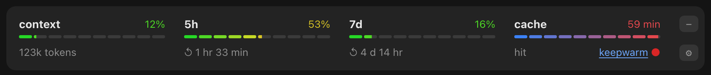
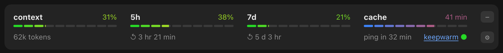
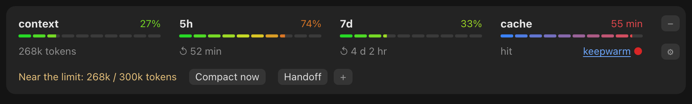
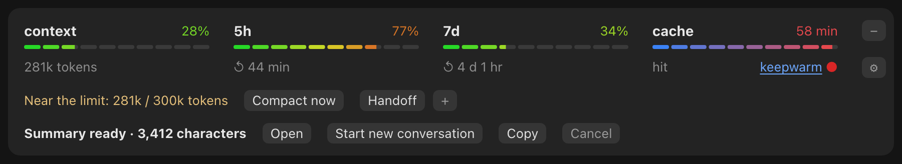
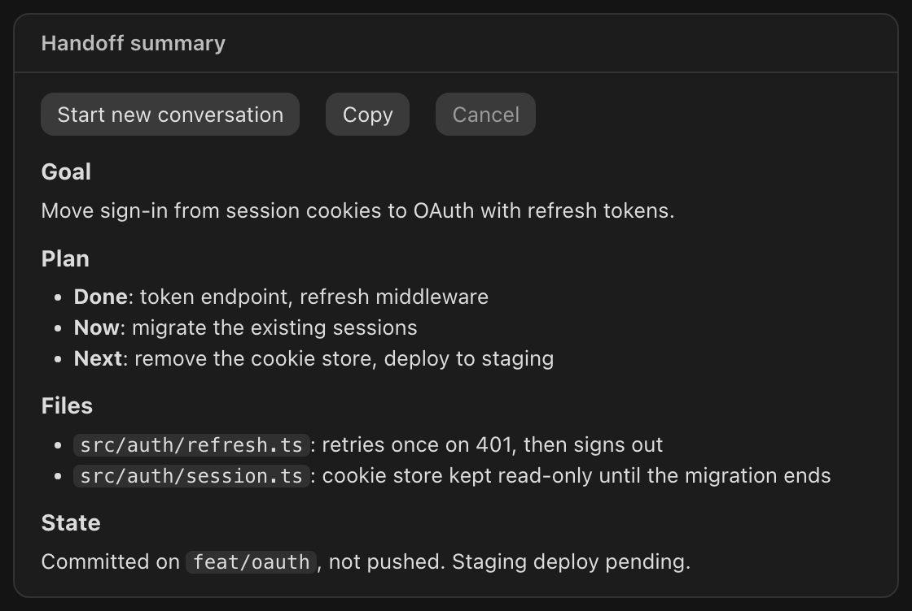
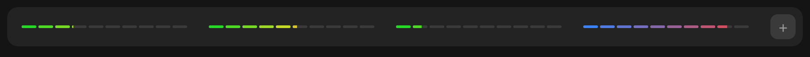
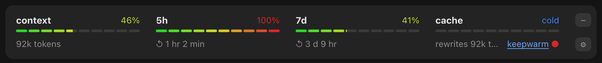
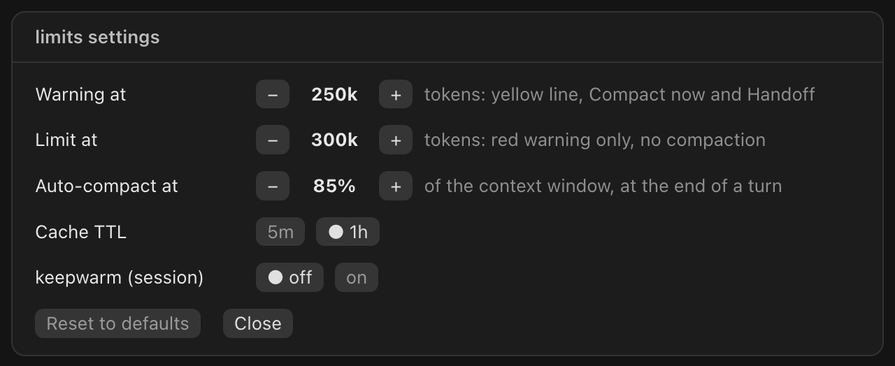

# limits

A Claude Code mod that puts your usage above the prompt, and helps you act on it before it costs you.



- **Four cards**: context, 5-hour limit, 7-day limit and prompt cache. Each has a thin bar of ten steps that fill in part and run from green to red; the cache card runs from red (just written) to blue (about to expire).
- **keepwarm**: click **keepwarm** on the cache card (the dot is green when on, red when off), switch it in the settings pane, or run `/keepwarm [on|off]`. While on, a minimal request re-reads the cache shortly before it expires, for up to 6 hours after your last message. It applies to the session you turn it on in, and every new session starts with it off. Each ping costs tokens and counts toward your limits; a compaction rewrites the cache, so it stops pinging until your next turn.
- **Handoff**: `/handoff [what to keep]`, or the Handoff button that appears past 250k tokens (with **+** to say what matters most). The model writes a summary of goal, plan, decisions, files touched and commit/deploy state; it opens in a pane of its own, in Markdown, to review; then the mod runs `/clear` and sends the summary as the first message of a clean conversation. Nothing is written to your project. The old conversation stays available through `/resume`.
- **Context guard**: a warning at 250k tokens with a **Compact now** button, a red warning at 300k (a warning only: it does not compact), and automatic compaction at the end of a turn above 85% of the window. All three are settings.
- **Minimized view**: **−** above the ⚙ shrinks the band to one row with the four bars alone, thinner and without text; **+** brings the cards back. The choice is kept for the next sessions.
- **Auto-resume**: when a turn stops on a usage limit, the mod waits for the reset and continues the work by itself.

Reset times read as in Claude's own usage panel: `2 hr 23 min`, `4 d 16 hr`.

## States

The images in this README are rendered from the mod's own bars, colors and strings with `docs/screenshots.ts`, since each state takes a long session to reach; the band in Claude Code draws the same elements in its own fonts.

**keepwarm on**: the dot turns green and the cache card counts down to the next ping.



**Near the limit**: past 250k tokens the band offers to compact now or hand off to a clean conversation.



**Handoff under review**: the summary opens in a pane beside the transcript, in Markdown, scrolled like any pane, with **Start new conversation**, **Copy** and **Cancel**. The band keeps one line for it, with **Open** to bring the pane back once closed.





**Minimized**: one row, the four bars alone. Warnings and buttons come back with **+**; a summary under review stays in its pane.



**Usage limit reached**: the 5-hour window is full and the cache has gone cold. The status line counts down to the reset, then the mod resumes the work by itself.



## Install

Requires a Claude Code version with mods.

```sh
claude plugin marketplace add justmorenoise/claude-code-limits
claude plugin install limits@justmorenoise
```

## Settings

Press **⚙** at the end of the band, or run `/limits`, to open the settings pane. Each change is saved at once and the band follows it.



| Setting | Values | Default |
| --- | --- | --- |
| `warnTokens` | 50k up to a step below the limit, in steps of 25k | `250000` |
| `limitTokens` | a step above the warning up to 2M | `300000` |
| `compactAt` | 50% to 95% of the context window, in steps of 5 | `85` |
| `cacheTtl` | `1h`, `5m` | `1h` |
| keepwarm | `on`, `off`, for the current session only | `off` |

The first four are the plugin's options: the pane writes them, and they can also be set when installing, with `/config` in a terminal, or in `settings.json`:

```json
{ "pluginConfigs": { "limits": { "options": { "warnTokens": 400000, "limitTokens": 500000, "compactAt": 85, "cacheTtl": "1h" } } } }
```

A warning not below the limit, or a value out of range, falls back to the defaults, so a wrong setting never silences the warnings.

## Notes

- On the desktop app bars are drawn as SVG; in the terminal they fall back to colored cells.
- Where Claude Code does not let a mod compact directly (the desktop app's Code tab, the SDK), **Compact now** and auto-compaction run `/compact` instead, with the same instructions.
- The handoff runs `/clear` from the mod. If your Claude Code refuses it, the summary stays on screen with a note to clear and paste it yourself.

## Development

```sh
claude plugin validate .
claude plugin test .
node docs/screenshots.ts   # re-renders the state images
```

## License

MIT
